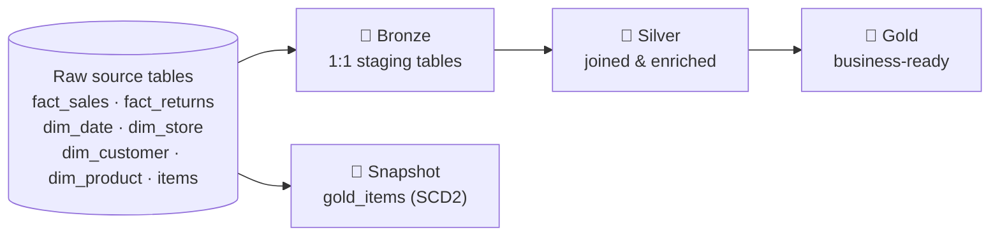

<div align="center">

# 🧱 Medallion Analytics with dbt + Databricks

**Raw retail data → clean, tested, analytics-ready tables, built layer by layer.**


</div>

---

## ✨ What is this?

A hands-on analytics-engineering project that turns a retail **sales & returns** dataset sitting in Databricks into a trustworthy, documented, tested warehouse using **dbt**. It follows the **medallion architecture** (🥉 Bronze → 🥈 Silver → 🥇 Gold) and also covers the dbt features you actually meet on the job: sources, data tests, snapshots (SCD Type 2), seeds, custom macros and Jinja.

## 🗺️ Architecture



| Layer | Models | What happens here |
|---|---|---|
| 🥉 **Bronze** | `bronze_sales`, `bronze_returns`, `bronze_date`, `bronze_store`, `bronze_customer`, `bronze_product` | One model per source table, materialized as **tables**. Raw data, made referenceable with `ref()`. |
| 🥈 **Silver** | `silver_sales_info`, `silver_sales_returns` | Sales joined with product and customer details; sales joined with returns and refund reasons. |
| 🥇 **Gold** | `gold_sales_info`, `source_gold_items` | Gross sales by product and gender; the latest, de-duplicated record per item (`row_number()` over `updateDate`). |

## 🧰 What's inside

- **Sources**: 7 declared source tables, with `source()` used for lineage.
- **Data tests**: generic `not_null` and `unique` tests on key columns, plus a singular test (`tests/non_negative.sql`) that flags negative gross or net amounts.
- **Snapshot**: `gold_items` tracks history of changing items with the `timestamp` strategy (SCD Type 2).
- **Seed**: `lookup.csv`, a small reference dataset loaded with `dbt seed`.
- **Macro**: `multiply(col1, col2)`, a tiny reusable Jinja macro.
- **Analyses**: Jinja playground files (`set`, `for`, `if`, `loop.last`, macros) in `analyses/`.

## 📁 Project structure

```text
.
├── pyproject.toml / uv.lock        # Python deps pinned with uv (dbt-core, dbt-databricks)
└── harsh_dbt_youtube/              # the dbt project
    ├── dbt_project.yml
    ├── profiles.yml.example        # connection template (real profiles.yml is git-ignored)
    ├── models/
    │   ├── source/sources.yaml     # raw source definitions
    │   ├── bronze/                 # staging tables + properties.yml (tests)
    │   ├── silver/                 # joined, enriched models
    │   └── gold/                   # business-ready models
    ├── snapshots/gold_items.yml    # SCD2 snapshot
    ├── seeds/lookup.csv
    ├── macros/multiply.sql
    ├── tests/non_negative.sql
    └── analyses/                   # Jinja experiments
```

## 🚀 Getting started

**Prerequisites:** [uv](https://docs.astral.sh/uv/), Python 3.12 and a Databricks SQL warehouse with a personal access token.

```bash
# 1. Install dependencies into a local .venv (Python 3.12)
uv sync

# 2. Configure your connection (never commit this file!)
cd harsh_dbt_youtube
cp profiles.yml.example ~/.dbt/profiles.yml   # then edit host, http_path, token

# 3. Check the connection
uv run dbt debug

# 4. Build everything
uv run dbt seed
uv run dbt run
uv run dbt test
uv run dbt snapshot

# Or build and test in dependency order in one go
uv run dbt build

# Browse docs and lineage
uv run dbt docs generate && uv run dbt docs serve
```

Use `--target prod` to run against the production catalog.

## 🔐 Security

Credentials never live in this repo. `profiles.yml`, `.env*`, logs and `target/` are git-ignored, and `profiles.yml.example` only holds placeholders. If you ever commit a token by accident, revoke it in Databricks right away.

## 🛠️ Tech stack

`dbt-core` · `dbt-databricks` · `Databricks SQL` · `Jinja` · `Python 3.12` · `uv`

---

<div align="center">

Built while learning analytics engineering, by [@hchhabra1999](https://github.com/hchhabra1999) ⭐ Star the repo if it helped!

</div>
